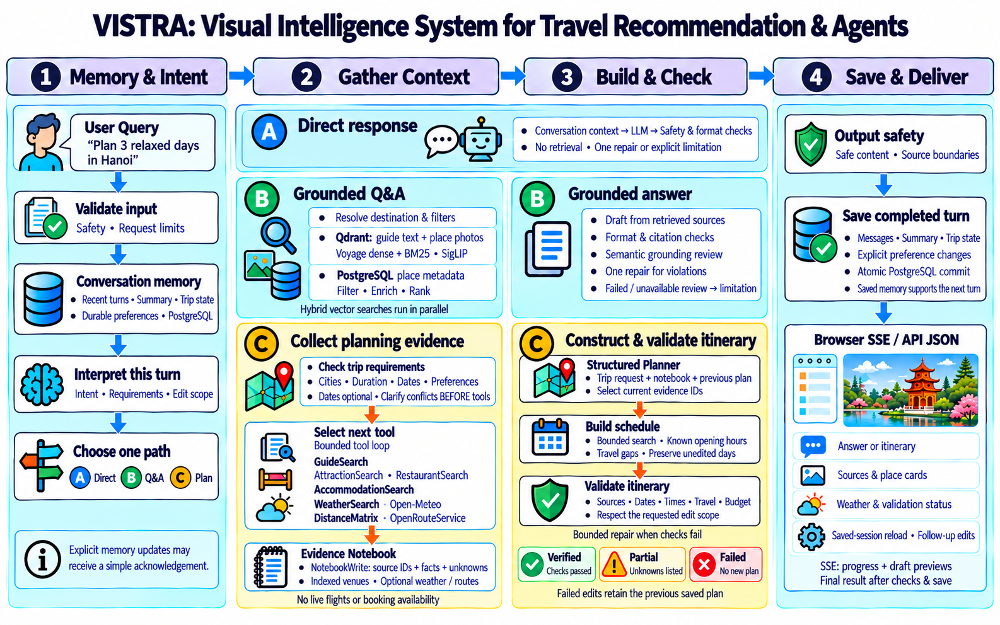
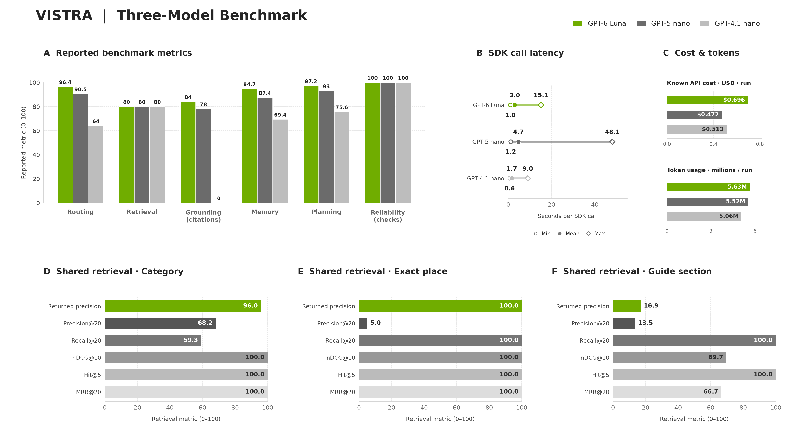

# VISTRA — Visual Intelligence System for Travel Recommendation & Agents

**Your travel companion, with memory.**

VISTRA is an AI travel assistant for Vietnam, combining travel guides, place
photos, conversation memory and itinerary planning. Users can explore destinations,
ask source-based questions and refine a trip through follow-up messages.

## System overview

VISTRA loads conversation memory, interprets the request and selects a direct
reply, grounded Q&A or planning path. It retrieves relevant evidence, builds and
checks the answer or itinerary, then saves the completed turn for future edits.
PostgreSQL stores memory and place metadata; Qdrant supports guide and photo
retrieval. Weather and optional route estimates inform planning, while missing
evidence is identified in partial results.

## Benchmark overview

The benchmark compares **GPT-5 nano, GPT-6 Luna and GPT-4.1 nano** across routing,
retrieval, grounding, memory, planning and reliability. It contains **600 English
and Vietnamese cases** from 300 scenario families. The current runner supports
**408/600 cases (68%)**, with 192 unsupported. A separate **100-case retrieval
supplement** evaluates the actual index.

The overview shows behavioral checks, citation presence, retrieval metrics,
SDK-call latency, token usage and estimated API cost. GPT-6 Luna leads the
observed routing, memory and structural planning checks; GPT-4.1 nano has the
lowest mean SDK latency, and GPT-5 nano has the lowest recorded cost estimate.
Retrieval results are shared across all three configurations.

These are development measurements, not overall accuracy: citation presence does
not establish factual correctness, and structural planning checks do not prove
complete itinerary feasibility.

[Benchmark description](benchmarks/BENCHMARK_DESCRIPTION.md) ·
[Three-model results](benchmarks/runs/model-comparison/REPORT.md) ·
[Mô tả tiếng Việt](benchmarks/BENCHMARK_DESCRIPTION_VI.md)
