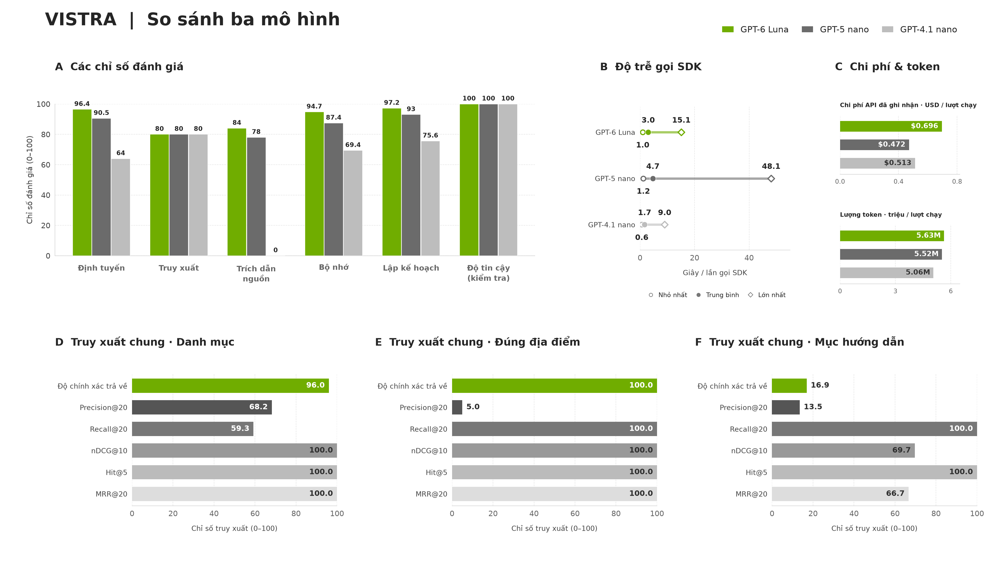

# Mô tả bộ đánh giá VISTRA

[English version](BENCHMARK_DESCRIPTION.md)

Bộ đánh giá VISTRA so sánh hệ thống trợ lý du lịch khi sử dụng **GPT-5 nano,
GPT-6 Luna và GPT-4.1 nano**. Sáu nhóm được đánh giá gồm định tuyến, truy xuất,
chẩn đoán trích dẫn nguồn, bộ nhớ, lập kế hoạch và độ tin cậy. Kết quả phản ánh
các lượt chạy phát triển đã lưu, chưa đại diện cho năng lực tổng quát của mô hình
hoặc mức độ sẵn sàng triển khai thực tế.

Thiết kế lấy cảm hứng từ TravelPlanner thông qua các ràng buộc rõ ràng và bằng
chứng có thể kiểm chứng, đồng thời bổ sung tình huống hội thoại và truy xuất
phù hợp với VISTRA. Các lượt chạy này chưa triển khai quy trình đánh giá chính
thức của TravelPlanner và chưa có độ bao phủ tương đương về lập lịch trình.

## Biểu đồ tổng quan dùng cho thuyết trình



Biểu đồ có kích thước **3840 × 2160 pixel, tỷ lệ 16:9**. Trong các phần A–C,
màu xanh thể hiện GPT-6 Luna; xám đậm và xám nhạt lần lượt thể hiện GPT-5 nano và
GPT-4.1 nano. Phần A trình bày sáu chỉ số; phần B trình bày độ trễ từng lần gọi
SDK; phần C trình bày chi phí và lượng token của toàn lượt chạy bộ tình huống.

Các phần D–F trình bày truy xuất sau xử lý theo từng nhóm truy vấn. Mỗi nhóm chỉ
hiển thị một lần vì kết quả giống nhau ở cả ba cấu hình mô hình. Tại đây, các sắc
màu phân biệt chỉ số, không phân biệt mô hình. Pipeline Voyage/BM25/SigLIP dùng
chung thực hiện truy xuất mà không gọi LLM để sinh câu trả lời.

Thang **0–100** được tạo bằng cách nhân các giá trị chuẩn hóa với 100. Điểm xếp
hạng như nDCG hoặc MRR không phải tỷ lệ câu trả lời đúng.

## Dữ liệu và độ bao phủ thực thi

Bộ tình huống được biên soạn gồm **300 nhóm kịch bản**, chia đều 50 nhóm cho mỗi
lĩnh vực. Mỗi nhóm có một phiên bản tiếng Anh và một phiên bản tiếng Việt có dấu,
tổng cộng **600 ca kiểm thử cho mỗi cấu hình mô hình**. Một ca có thể chứa nhiều
lượt hội thoại theo thứ tự; bộ đánh giá không chỉ gồm câu hỏi và câu trả lời đơn.

| Nhóm trong bộ tình huống | Số ca | Có thể thực thi | Chưa được hỗ trợ |
| --- | ---: | ---: | ---: |
| Định tuyến | 100 | 100 | 0 |
| Truy xuất | 100 | 0 | 100 |
| Trích dẫn và căn cứ nguồn | 100 | 100 | 0 |
| Bộ nhớ | 100 | 98 | 2 |
| Lập kế hoạch | 100 | 86 | 14 |
| Độ tin cậy | 100 | 24 | 76 |
| **Tổng** | **600** | **408** | **192** |

Độ bao phủ thực thi là **68%**, không phải điểm chất lượng. GPT-5 nano hoàn thành
404 trong 408 ca có thể thực thi; bốn ca bị gián đoạn do tác động bên ngoài. Hai
cấu hình còn lại hoàn thành 408 ca. Một ca hoàn thành vẫn có thể chứa lỗi ở từng
lượt hội thoại hoặc phép kiểm tra không đạt. Ca chưa được hỗ trợ được ghi nhận
là chưa đo, không tự động tính là đạt hoặc không đạt.

Bộ truy xuất bổ sung trên chỉ mục thực gồm **100 ca riêng biệt**: 50 truy vấn theo
danh mục, 30 truy vấn đúng địa điểm và 20 truy vấn mục hướng dẫn. Mỗi cấu hình
hoàn thành đủ 100 ca, không có lỗi ca kiểm thử. Bộ bổ sung dùng tình huống và nhãn
khác với nhóm truy xuất giả lập trong bộ 600 ca, nên không thay thế 100 ca chưa
được hỗ trợ ở bảng trên.

## Ý nghĩa sáu chỉ số trong biểu đồ tổng quan

| Chỉ số | Cách tính và phạm vi |
| --- | --- |
| Định tuyến | `100 × số phép kiểm tra đạt / (số đạt + số không đạt)` cho các phép kiểm tra đã triển khai về chế độ trả lời, hành động và phạm vi. |
| Truy xuất | Tỷ lệ mục hướng dẫn được yêu cầu xuất hiện trong ngữ cảnh sinh câu trả lời: `100 × 16/20 = 80`. Đây là một chỉ số của bộ bổ sung, không phải điểm truy xuất tổng hợp. |
| Trích dẫn nguồn | Số ca hoàn thành thuộc nhóm grounding có ít nhất một trích dẫn đúng cú pháp nhận diện `[S#]`, chia cho số ca hoàn thành của nhóm, nhân 100. Có trích dẫn chưa chứng minh nội dung được nguồn hỗ trợ. |
| Bộ nhớ | Tỷ lệ đạt của các phép kiểm tra đã triển khai về giá trị trạng thái, thao tác ghi và bảo toàn thông tin. Chưa đánh giá đầy đủ ngữ nghĩa sở thích. |
| Lập kế hoạch | Tỷ lệ đạt của các phép kiểm tra cấu trúc lịch trình như ngày, khung bữa ăn, định danh nguồn và phần kế hoạch cần giữ nguyên khi chỉnh sửa. Chưa chứng minh toàn bộ lịch trình khả thi về di chuyển, ngân sách và thời gian. |
| Độ tin cậy | Tỷ lệ đạt của 46 phép kiểm tra API và từ chối đầu vào đã triển khai, chỉ bao phủ 24 ca. Chưa chứng minh khả năng chịu lỗi tổng quát khi dịch vụ hoặc thành phần phụ thuộc gặp sự cố. |

Các tỷ lệ hành vi loại những phép kiểm tra chưa được chấm khỏi mẫu số. Phép kiểm
tra có điều kiện có thể tạo mẫu số khác nhau giữa các mô hình. Khi lập biểu đồ,
cùng bốn mã ca bị gián đoạn bên ngoài được loại khỏi phần so sánh hành vi của cả
ba cấu hình. Báo cáo toàn lượt chạy vẫn giữ số đếm gốc; do đó, một số tỷ lệ trên
biểu đồ khác với phép chia trực tiếp từ bảng số đếm trong báo cáo đầy đủ.

| Chỉ số hiển thị, 0–100 | GPT-6 Luna | GPT-5 nano | GPT-4.1 nano |
| --- | ---: | ---: | ---: |
| Định tuyến | 96.4 | 90.5 | 64.0 |
| Truy xuất: mục hướng dẫn trong ngữ cảnh | 80.0 | 80.0 | 80.0 |
| Trích dẫn nguồn: có trích dẫn nhận diện được | 84.0 | 78.0 | 0.0 |
| Bộ nhớ | 94.7 | 87.4 | 69.4 |
| Lập kế hoạch: kiểm tra cấu trúc | 97.2 | 93.0 | 75.6 |
| Độ tin cậy: các phép kiểm tra phạm vi hẹp | 100.0 | 100.0 | 100.0 |

GPT-4.1 nano trả lời không rỗng ở cả 100 ca grounding, nhưng không dùng cú pháp
trích dẫn được bộ chấm nhận diện. Điểm trích dẫn bằng 0 không có nghĩa độ chính
xác thực tế bằng 0. **Không có điểm chính xác tổng thể hoặc trung bình cộng sáu
chỉ số**, vì chúng khác nhau về phạm vi và mẫu số.

## Các chỉ số truy xuất chi tiết

Các chỉ số được tính cho từng truy vấn trên kết quả không trùng lặp, sau đó lấy
trung bình trong từng nhóm. Gọi `R` là tập kết quả liên quan theo nhãn và `L` là
danh sách trả về, lấy tối đa 20 kết quả.

| Chỉ số | Định nghĩa |
| --- | --- |
| Độ chính xác trả về | Số kết quả liên quan trong `L` chia cho số kết quả thực tế trả về. Danh sách rỗng được tính bằng 0. |
| Precision@20 | Số kết quả liên quan trong `L` chia cho 20, kể cả khi trả về ít hơn 20 kết quả. |
| Recall@20 | Số kết quả liên quan trong `L` chia cho kích thước tập `R`. |
| nDCG@10 | Tổng độ liên quan nhị phân ở mười vị trí đầu, giảm trọng số theo `log2(thứ hạng + 1)`, chia cho tổng lý tưởng. |
| Hit@5 | Bằng 1 nếu ít nhất một kết quả liên quan xuất hiện trong năm vị trí đầu, ngược lại bằng 0. |
| MRR@20 | Trung bình nghịch đảo thứ hạng của kết quả liên quan đầu tiên trong 20 vị trí. Truy vấn có kết quả liên quan nhưng không tìm được kết quả nào được tính bằng 0. |

| Chỉ số sau xử lý, 0–100 | Danh mục, 50 ca | Đúng địa điểm, 30 ca | Mục hướng dẫn, 20 ca |
| --- | ---: | ---: | ---: |
| Độ chính xác trả về | 96.0 | 100.0 | 16.9 |
| Precision@20 | 68.2 | 5.0 | 13.5 |
| Recall@20 | 59.3 | 100.0 | 100.0 |
| nDCG@10 | 100.0 | 100.0 | 69.7 |
| Hit@5 | 100.0 | 100.0 | 100.0 |
| MRR@20 | 100.0 | 100.0 | 66.7 |

Hai truy vấn danh mục không có địa điểm liên quan trong chỉ mục. Chúng đóng góp
giá trị 0 cho các chỉ số precision; Recall, nDCG, Hit và nghịch đảo thứ hạng không
xác định nên được loại khỏi các trung bình tương ứng, còn 48 truy vấn hợp lệ cho
những chỉ số này. Việc trả về rỗng đúng được ghi nhận riêng. Một truy vấn đúng
địa điểm trả về duy nhất một kết quả đúng có độ chính xác trả về 100, nhưng
Precision@20 chỉ bằng 5 theo định nghĩa mẫu số cố định.

Nhãn liên quan dựa trên siêu dữ liệu địa điểm và nhãn mục hướng dẫn, chưa phải
đánh giá độc lập của con người trên nội dung ảnh hoặc từng câu văn. Bộ lọc danh
mục và tên địa điểm cải thiện kết quả sau xếp hạng embedding ban đầu. Recall bị
giới hạn khi có hơn 20 địa điểm liên quan. Vì vậy, điểm sau xử lý cao chưa chứng
minh năng lực hiểu ảnh tổng quát hoặc chất lượng của riêng bộ xếp hạng embedding.

## Độ trễ, token và chi phí

Phần B trình bày độ trễ nhỏ nhất, trung bình cộng và lớn nhất trên các lần gọi
SDK đã ghi nhận đủ dữ liệu. Vòng tròn rỗng là nhỏ nhất, vòng tròn đặc là trung
bình và hình thoi là lớn nhất. Đây là từng lần gọi nhà cung cấp, không phải thời
gian phản hồi giao diện, toàn bộ một lượt hay cả cuộc hội thoại. Các lần gọi có
thể khác nhau về giai đoạn xử lý, độ dài đầu vào và trạng thái bộ nhớ đệm.

| Mô hình | Lần gọi hợp lệ | Nhỏ nhất, giây | Trung bình, giây | Lớn nhất, giây | Token đầu vào + đầu ra toàn lượt chạy | Chi phí đã ghi nhận, USD |
| --- | ---: | ---: | ---: | ---: | ---: | ---: |
| GPT-6 Luna | 1,563 | 0.985 | 2.999 | 15.147 | 5,630,169 | 0.69613542 |
| GPT-5 nano | 1,424 | 1.225 | 4.718 | 48.086 | 5,515,255 | 0.47178779 |
| GPT-4.1 nano | 1,458 | 0.648 | 1.679 | 9.034 | 5,055,124 | 0.51321010 |

Các cột ở phần C dùng lượng sử dụng đã ghi nhận của toàn lượt chạy, độc lập với
các điểm độ trễ cực trị. Tổng token bằng token đầu vào cộng đầu ra. Token đọc/ghi
bộ nhớ đệm là tập con của đầu vào; token suy luận đã nằm trong đầu ra, nên không
được cộng thêm lần nữa. Chi phí là ước tính theo bảng giá Standard đã lưu và
thông tin bộ nhớ đệm sẵn có, không phải giá hiện tại hoặc hóa đơn đã đối soát.

Hai sự kiện SDK của GPT-4.1 nano thiếu dữ liệu sử dụng nên bị loại khỏi nhóm tính
độ trễ hợp lệ. Các ca GPT-5 nano bị gián đoạn có thể có lần gọi chưa được ghi nhận.
Không xem phần thiếu dữ liệu là miễn phí. Chi phí kiểm tra tương thích trước khi
chạy, Jev, tài nguyên tính toán cục bộ và các lần thử lại nội bộ SDK chưa ghi nhận
nằm ngoài ước tính trên. Trạng thái bộ nhớ đệm chưa được kiểm soát giữa các lượt.

## Diễn giải kết quả và bước đánh giá tiếp theo

GPT-6 Luna có tỷ lệ đạt cao nhất ở định tuyến, bộ nhớ và kiểm tra cấu trúc kế
hoạch trong lượt chạy này. GPT-4.1 nano có độ trễ SDK trung bình thấp nhất, nhưng
nhiều phép kiểm tra hành vi không đạt hơn và không có trích dẫn được nhận diện.
GPT-5 nano có chi phí toàn lượt chạy thấp nhất trong phần sử dụng đã ghi nhận.
Kết quả truy xuất dùng chung nên không dùng để xếp hạng năng lực truy xuất của LLM.

Đây là kết quả chẩn đoán phát triển từ một lượt chạy. Nhãn biên soạn cần được
thẩm định độc lập; nhiều tiêu chí ngữ nghĩa và cơ chế mô phỏng lỗi chưa được chấm
hoặc chưa được hỗ trợ. Mô hình tự duyệt không phải đánh giá chất lượng độc lập.
Cần kiểm tra riêng tính khả thi đầy đủ của lịch trình, mức độ nguồn hỗ trợ từng
phát biểu, tính hữu ích và tỷ lệ hoàn thành nhiệm vụ trước khi kết luận chất
lượng lập kế hoạch trong thực tế.

## Bằng chứng và cách tạo lại biểu đồ

- [Báo cáo ba mô hình](runs/model-comparison/REPORT.md) và
  [dữ liệu tổng hợp](runs/model-comparison/summary.json).
- [Quy trình chạy bộ tình huống](evaluation/README.md).
- [Quy trình đánh giá truy xuất](retrieval/README.md) và
  [kết quả trên chỉ mục thực](runs/gpt-5-nano/retrieval/REPORT.md).
- [Dữ liệu tình huống cục bộ](vistra/) và
  [quy trình kiểm tra hồi quy khi phát triển](measurement/README.md).
- [Mã tạo biểu đồ](plot/overview.py) và
  [ảnh tổng quan tiếng Việt](plot/benchmark_overview_vi.png).

Từ thư mục gốc của dự án, tạo lại bản tiếng Việt mà không gọi mô hình:

```powershell
.\.venv\python.exe -B benchmarks/plot/overview.py --lang vi
```

Chương trình dùng Matplotlib đã cài riêng trong `.cache/benchmark-plots`, xác
minh mã băm của kết quả và bằng chứng sử dụng, đồng thời nhúng nguồn gốc dữ liệu
vào siêu dữ liệu PNG. Chỉ ảnh tổng quan tiếng Việt được ghi lại; thư mục `plot/`
vẫn chỉ chứa PNG và Python. Bằng chứng thô và bộ tình huống vẫn được giữ cục bộ
ở những phần không đưa lên bản phân phối báo cáo tóm tắt trên GitHub.
